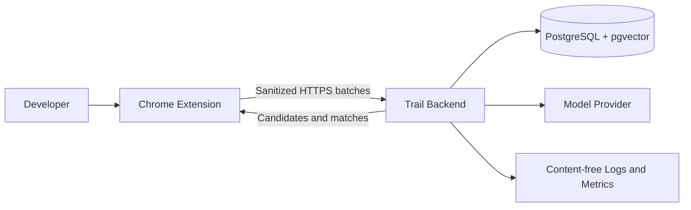

# High-Level Architecture

## Architectural position

Build a **single backend application plus PostgreSQL/pgvector**. The Chrome extension contains all user interface surfaces. AI is exposed only through internal enrichment and similarity services.

## Core components

### Chrome extension

- Captures and sanitizes eligible top-level navigation metadata.
- Maintains a bounded offline upload queue.
- Shows capture state, active candidate, solution prompt, solved-problem library, recommendation card, and replay.
- Enforces pause and domain exclusions before local persistence or transmission.

### Backend application

One deployable process owns:

- email/password authentication, email verification/reset, JWT access, and rotating refresh sessions;
- capture ingestion and short-lived event retention;
- deterministic debugging detection and session boundaries;
- Problem Session commands and queries;
- AI enrichment orchestration;
- lexical/vector similarity retrieval;
- recommendation suppression and feedback;
- deletion and retention jobs;
- typed global feature flags for AI Suggestions, Ghost Replay, Semantic Search, and explicitly experimental behavior.

Logical modules are useful; separate services are not.

### PostgreSQL with pgvector

The database is the source of truth for candidate/solved sessions, ordered artifacts, final solutions, embeddings, and recommendation feedback. It also acts as the small durable work queue for enrichment retries.

### AI providers

`AIProvider` and the separate `EmbeddingProvider` receive bounded, policy-filtered session text only for:

- concise problem summary;
- technology/framework extraction;
- problem classification and error normalization;
- embeddings.

Business services never depend on Gemini, OpenAI, Ollama, or local SDKs directly. Configuration selects one production adapter per port plus mock adapters for tests. Providers never receive cookies, page bodies, credentials, arbitrary private URLs, or access to tools/code execution.

## Principal flows

### Capture and candidate formation

1. Extension sanitizes an eligible navigation.
2. Backend validates, deduplicates, and stores it with short retention.
3. Deterministic signals append it to or start a likely debugging candidate.
4. Candidate state is returned through ordinary API reads.
5. Inactivity or manual finish closes the capture window and makes the candidate reviewable.

### Solved-memory creation

1. User confirms `Solved` and submits the final solution.
2. Backend transaction stores the exact user text and marks the session solved.
3. Deterministic search fields become available immediately.
4. A PostgreSQL-backed job enriches and embeds the session.
5. Failed AI work retries without blocking the saved memory.

### Similarity recall

1. Current debugging signals cross a conservative threshold.
2. Backend constructs a bounded current-problem document.
3. An embedding is generated only after meaningful change and with rate limits.
4. PostgreSQL retrieves the user’s solved sessions.
5. A deterministic ranker combines vector, error phrase, technology, and lexical overlap.
6. The extension receives at most one unsuppressed match.

## Removed infrastructure

- Redis and distributed cache.
- WebSockets and streaming.
- Kafka or another message broker.
- Graph database.
- Dedicated vector database.
- Object storage.
- Separate worker deployment.
- Separate React website.
- Kubernetes and multi-region deployment.

## Deployment and observability

- Render is the v1.1 target: one Docker web service and Render Postgres in one region using the internal/private connection.
- Spring Boot Actuator and Micrometer expose minimal health, liveness, readiness, and private metrics.
- SLF4J/Logback emits structured JSON logs with content-safe fields.
- Grafana, Prometheus, OpenTelemetry, distributed tracing, and Kubernetes are deferred.

## Consistency

- Capture acknowledgment means the event is durably stored, not classified correctly.
- Final solution writes are strongly consistent and never AI-authored.
- Enrichment and embeddings are eventually consistent.
- Similarity quietly degrades to lexical/error matching when embeddings are unavailable.
- Recommendations are advisory and may be dismissed without changing historical memory.

## Future scalability seams

Keep module boundaries around capture, problems, intelligence, and retrieval. Extract a worker or dedicated search system only after measured latency, throughput, or failure isolation requires it.
