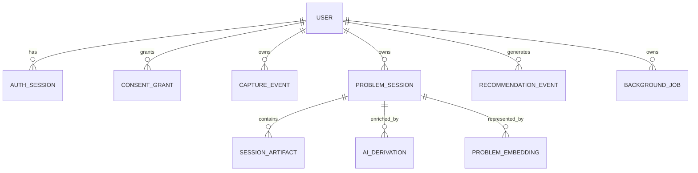

# Database Design

## Principles

- Problem Session is the primary product entity.
- The developer-authored final solution is canonical and distinguishable from AI-derived text.
- Raw capture is short-lived; solved memories are durable until deletion.
- Every user-owned row carries `user_id`.
- URLs, queries, titles, solutions, and embeddings are sensitive.
- Similarity is computed between embeddings; it is not a permanent `similarity_score` property of a session.

## Entity relationships

## Tables

### `users`

Minimal account identity: `id`, normalized unique email, Argon2id password hash, email verification timestamp, status, created/updated timestamps, deletion timestamp. Email is not used as a foreign key; ownership always uses immutable user ID.

### `auth_sessions`

Hashed extension refresh credential, user ID, created/last-used/expiry/revoked timestamps, and client type. Keep the model narrow; no device-management dashboard in MVP.

### `email_action_tokens`

Hashed single-use token, user ID, purpose (`VERIFY_EMAIL` or `RESET_PASSWORD`), expiry, consumed timestamp, and creation timestamp. Never store raw tokens. Index active token hash and expiry; purge expired/consumed records.

### `consent_grants`

Append-only policy version, capture scope, grant/withdraw timestamps, and user ID. User domain exclusions remain local in the extension for MVP so blocked metadata never reaches the server.

### `capture_events`

| Field group | Fields |
|---|---|
| Identity | ID, user ID, client event ID |
| Navigation | sanitized URL, hostname, bounded title, event/resource type |
| Search | optional allowlisted search query |
| Context | tab-session ID, optional parent client event ID, transition type |
| Time | occurred and received timestamps |
| Detection | candidate session ID, quality flags |
| Lifecycle | retention expiry, deleted timestamp |

Indexes:

- unique user/client-event ID;
- user plus occurred time;
- candidate-session ID plus occurred time;
- retention expiry.

Ungrouped raw events expire after seven days. Events used by a solved session are copied into durable artifacts; raw rows may then expire.

### `problem_sessions`

| Field | Purpose |
|---|---|
| ID, user ID | Ownership |
| status | Candidate, reviewable, solved, unsolved, dismissed, deleted |
| problem title | User-confirmed or deterministic/model suggestion |
| problem description | Optional user text |
| final solution | Exact authoritative user text; required for solved status |
| local note | One bounded optional note, not a note system |
| generated summary | AI-derived problem summary |
| technologies/frameworks | Bounded text arrays |
| problem type | Broad controlled category |
| error phrases | Bounded normalized text array |
| tags | Flat bounded labels, primarily derived/user-editable later |
| started/ended/duration | Session timing |
| detector/model versions | Reproducibility |
| search vector | PostgreSQL lexical search document |
| prompt state | Whether/when solution prompt may be shown again |
| timestamps/version | Lifecycle and optimistic updates |

Do not store a “time saved” estimate. Previous session duration is factual; saved time is not.

### `session_artifacts`

One ordered table for all evidence types:

- page;
- search query;
- documentation;
- GitHub repository/issue;
- discussion;
- video;
- AI-chat link;
- user note reference.

Fields: ID, user ID, problem-session ID, position, artifact type, sanitized URL, hostname, title, optional query text, occurred time, removed timestamp.

This replaces separate tables for pages, searches, repositories, videos, and AI chats. Their shared behavior matters more than type-specific schemas in MVP.

### `ai_derivations`

Stores problem-session ID, kind, provider/model, prompt key/version/hash, output schema and policy versions, input fingerprint, bounded generated summary/structured output, status, cost/latency, attempt metadata, and timestamps. The authoritative final solution is never stored here.

### `problem_embeddings`

Stores one model-versioned solved-session representation independently of the canonical Problem Session: ID, user/session IDs, model generation, dimensions, input fingerprint, fixed-dimension pgvector value, active/superseded timestamps.

Start with exact user-scoped comparison. A new vector dimension requires a new physical table/column generation and an explicit backfill/dual-read migration; do not mix incompatible dimensions in generic JSON.

### `recommendation_events`

Stores current candidate ID, recommended solved-session ID, retrieved solved-session IDs/ranks, referenced evidence/artifact IDs and codes, embedding generation, provider/model/prompt provenance where applicable, algorithm version, and shown/opened/helpful/not-related/dismissed timestamps. It never stores unrestricted provider payloads. The server derives `shown`; the client cannot submit arbitrary analytics.

### `background_jobs`

Durable jobs for enrichment, embedding, retention, and deletion: type, user/session IDs, state, attempt count, next attempt, safe error code, timestamps. Payloads contain IDs, not browsing content.

## Tables deliberately absent

- Journey relations, branches, split/merge corrections.
- Separate technology, framework, tag, page, video, repository, and query tables.
- Generic notes/documents.
- Chat messages.
- Graph nodes/edges.
- Export jobs and object keys.
- Redis/outbox/processed-message tables.
- Team, workspace, role, sharing, and billing tables.

## Vector indexing

Start with exact per-user vector comparison because early personal corpora are small. Add an HNSW/IVFFlat index only after corpus size and latency measurements justify it; benchmark user filtering and recall before enabling approximate search.

## Retention

| Data | MVP default |
|---|---|
| Ungrouped capture events | 7 days |
| Dismissed candidates | 24 hours |
| Unsolved candidates | User choice; otherwise 7 days |
| Solved sessions/artifacts | Until user deletion |
| Superseded AI derivations | 30 days |
| Recommendation feedback | 90 days or aggregated sooner |
| Content-free application logs | 14 days |
| Encrypted backups | Managed-provider minimum practical window, disclosed |

Retention values require founder/legal approval before beta.
