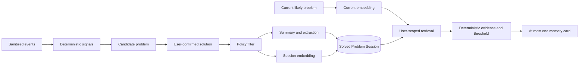

# AI Pipeline

## Mandate

AI remains invisible and performs only six product functions:

1. detect similar problems;
2. generate concise problem summaries;
3. extract technologies and frameworks;
4. classify broad problem types and normalize error phrases;
5. recommend previously solved sessions;
6. help recognize repeated debugging behavior after deterministic baselines.

AI does not chat, diagnose, browse, execute code, generate fixes, or author the final solution.

## Provider boundaries

- `AIProvider` performs structured enrichment only. Possible adapters are Gemini, OpenAI, Ollama, and Mock; v1.1 ships one selected production adapter plus Mock. Configuration `trail.ai.provider` selects it.
- `EmbeddingProvider` produces embeddings independently. Possible adapters are Gemini, OpenAI, Local, and Mock; v1.1 ships one selected production adapter plus Mock. Configuration `trail.embedding.provider` selects it.
- Business/application services import only these ports. Provider SDKs, request types, model names, and retry semantics remain in outbound adapters.
- AI and embedding providers may be changed independently only through model/prompt generation evaluation and migration.

## Pipeline

## Stage 1: deterministic debugging signals

Extract time gaps, query reformulation, technical-domain transitions, error-like phrases, repeated technology tokens, and manual boundaries. This stage runs without an LLM and creates explainable candidate reason codes.

Do not call a model per navigation. It increases privacy exposure, latency, cost, and noise without solving session boundaries.

## Stage 2: candidate review and solution truth

The user confirms whether the candidate was solved and writes the final solution. This happens before durable enrichment. The model cannot infer or fill this field.

## Stage 3: policy filter

Before a provider call:

- exclude blocked/private sources;
- strip URL parameters and use hostname/resource label instead of full URL;
- remove emails, tokens, UUID-like secrets, private IPs, file paths, and likely credentials;
- bound titles, search queries, problem text, final solution, and artifact count;
- send only fields needed for the requested derivation;
- never include cookies, page bodies, code repositories, or raw AI conversation content.

If redaction removes essential context, skip enrichment rather than sending broader data.

## Stage 4: structured enrichment

For a solved session, request a strict schema containing:

- concise neutral problem summary;
- bounded technologies/frameworks;
- one broad problem type such as configuration, dependency, authentication, build, runtime, database, networking, deployment, testing, or tooling;
- normalized error phrases already grounded in input;
- insufficient-context flag.

Reject invented technologies, URLs, facts, or fixes not supported by input. User text remains unchanged.

## Stage 5: embeddings

Create one solved-session embedding from a bounded canonical document containing:

- confirmed problem title/description;
- developer-authored final solution;
- extracted technologies/problem type/error phrases;
- search queries and representative artifact titles/domains.

Create a temporary current-problem embedding only after the current candidate crosses the debugging threshold and meaningfully changes. Rate-limit refreshes; do not embed every page.

Record provider, model, dimension, input fingerprint, and policy version. A model migration writes new vectors alongside or recomputes under an explicit migration plan.

## Stage 6: hybrid similarity

Retrieve only the user’s solved sessions. Combine:

- vector similarity;
- normalized error phrase overlap;
- technology/framework overlap;
- lexical similarity between current queries/titles and prior problem/solution;
- negative feedback suppression.

Require supporting evidence and conservative thresholds. Do not expose raw vector distance as a confidence percentage.

## Stage 7: recommendation

Return one match only if it clears the threshold and has not been suppressed. Explanations are deterministic. The system displays the user’s exact prior solution, not a newly generated answer.

For every recommendation, persist provider/model/prompt provenance where applicable, embedding generation, retrieved solved-session IDs and ranks, evidence codes, referenced prior artifacts, algorithm version, timestamp, and user outcome. This is the source for `Why this?`; never generate a rationale with an LLM.

## Evaluation corpus

Build an opt-in dogfood corpus of problem pairs labeled:

- same underlying problem;
- related technology but different problem;
- same error text with different cause;
- unrelated hard negative;
- recommendation helpful/not related.

Evaluate Recall@1, precision of shown recommendations, false prompts per debugging day, and cohort performance. Offline ranking metrics do not replace in-product helpfulness.

## Cost and failure controls

- One enrichment call and one embedding per solved session unless content changes materially.
- Bounded current-candidate embedding refresh.
- PostgreSQL job retries with backoff and daily provider budget.
- Input fingerprint caching.
- Lexical/error matching fallback.
- No generative reranker or larger model until measured quality requires it.

## Explicitly prohibited AI features

- Chat over history.
- Current-problem diagnosis.
- Generated final solutions.
- Code generation or execution.
- Autonomous web research.
- Productivity, performance, sentiment, or developer-skill scoring.
- Employer-facing behavioral analytics.
