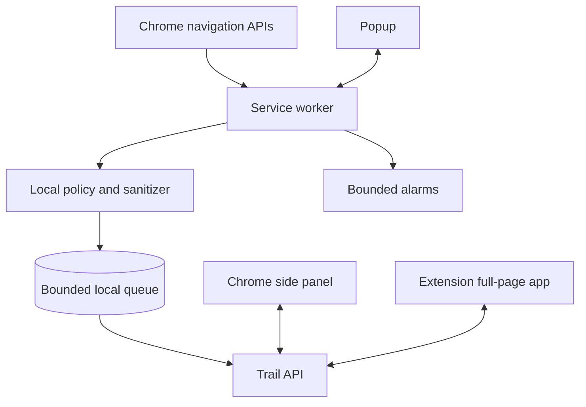

# Chrome Extension Design

## Role

The extension is Trail’s only MVP client. It quietly captures minimal debugging metadata, collects the developer’s final solution, shows prior-solution recommendations, and replays evidence.

It is not a sidebar assistant, chat surface, page scraper, or tab manager.

## MV3 components

## Service worker

- Listens to top-level navigation/tab lifecycle events.
- Rejects excluded schemes/hosts before persistence.
- Sanitizes URL/title/query metadata.
- Maintains ephemeral tab lineage and a bounded durable upload queue.
- Syncs batches with retry and idempotency.
- Polls bounded candidate/recommendation state on relevant events or alarms.
- Assumes suspension after every event; correctness does not depend on memory.

## Popup

The popup contains:

- recording/paused/error state;
- quiet candidate state such as `Problem session active`;
- `Start problem` or `Finish problem` when relevant;
- a single recommendation indicator;
- pause/resume and `Block this domain`;
- link to Problem Sessions.

It does not show chat, live AI prose, productivity metrics, capture counts, or browsing history.

## Full-page extension app

Provides:

- onboarding and consent;
- candidate review and final-solution prompt;
- solved Problem Session detail;
- similar-problem card and feedback;
- manual solved-problem search;
- session/account deletion and privacy settings.

There is no separate hosted web application in MVP.

## Chrome side panel

The side panel is the focused surface for Recall, the end-session flow, Similar Problem Found, and Ghost Replay. It opens only after a user gesture such as an action click, shortcut, or extension-page button. It stays beside the current webpage so the developer does not lose context.

The panel does not inject UI into the page and does not require a content script.

## Content scripts

None in MVP. Browser navigation/tab APIs provide URL/title metadata. This means AI-chat artifacts are links with titles, not captured conversation content.

Adding a content script for chat, code, page text, or errors would materially change the privacy model and requires a separate product/security review.

## Permissions

Validate exact requirements and Chrome warnings during the first implementation spike. Expected named permissions are:

- `storage` for queue/settings;
- `alarms` for bounded retry/state refresh;
- `tabs` for title/URL access and replay;
- `webNavigation` for top-level navigation events;
- `sidePanel` for Recall and Ghost Replay beside the current page;
- No `identity` permission is required for v1.1 email/password authentication.

Expected host permissions are limited to the configured Trail backend API origin. Local development uses `http://localhost:8080/*`; staging and production must replace it with the exact HTTPS Trail API origin approved for release. Broad host permissions such as `<all_urls>`, `http://*/*`, `https://*/*`, and `*://*/*` are not allowed.

Avoid history import, cookies, downloads, clipboard, debugger, scripting, content-script host access, broad website host access, and Incognito.

## Capture lifecycle

1. Receive committed top-level navigation.
2. Check local capture and exclusion state.
3. Permit only HTTP(S); reject private/local/prohibited hosts and credentials.
4. Remove fragments, trackers, and sensitive parameters.
5. Extract search query only from a versioned allowlist.
6. Bound and sanitize title/query/URL.
7. Write locally before network attempt.
8. Upload a bounded batch.
9. Remove only acknowledged/duplicate events.

## Solution prompt behavior

- Prompt only for a server-marked reviewable candidate or explicit manual finish.
- Never interrupt an active page with a modal.
- Open the full-page extension app from a badge/popup affordance.
- Ask `Did you solve it?`, then `What finally solved it?` only after `Solved`.
- Preserve entered text locally until acknowledged by the backend.
- At most one reminder after user deferral.

## Similar-problem card

- Shown only after the backend returns a thresholded, user-owned recommendation.
- Displays exact prior solution and deterministic match reason.
- Does not inject UI into arbitrary websites in MVP; the badge, popup, and Chrome side panel are sufficient.
- Once dismissed or marked unrelated, it does not reappear for the same candidate.

This is less flashy than an in-page overlay but avoids content scripts and reduces interruption/security risk.

## Replay

Revalidate HTTP(S) URLs locally. Open selected resources in order with explicit confirmation above five tabs and a hard cap. Do not fetch links server-side or check them automatically.

## Extension tests

- Worker suspension and browser restart.
- Duplicate/redirect/navigation ordering.
- Offline queue and auth expiry.
- Local exclusion before queueing.
- Malicious/internationalized URLs and titles.
- Solution text persistence during transient failure.
- Prompt/recommendation suppression.
- Replay scheme/count validation.
- Packet inspection against declared payloads.
